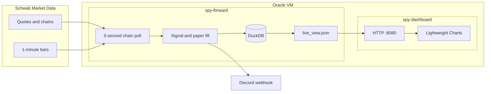
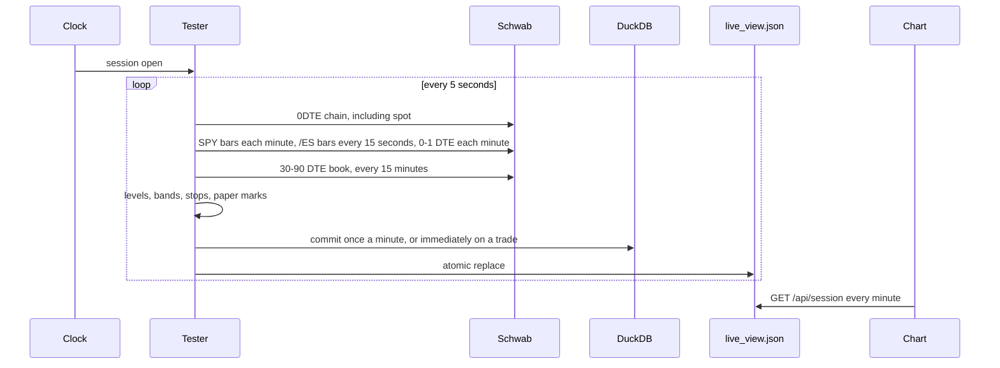
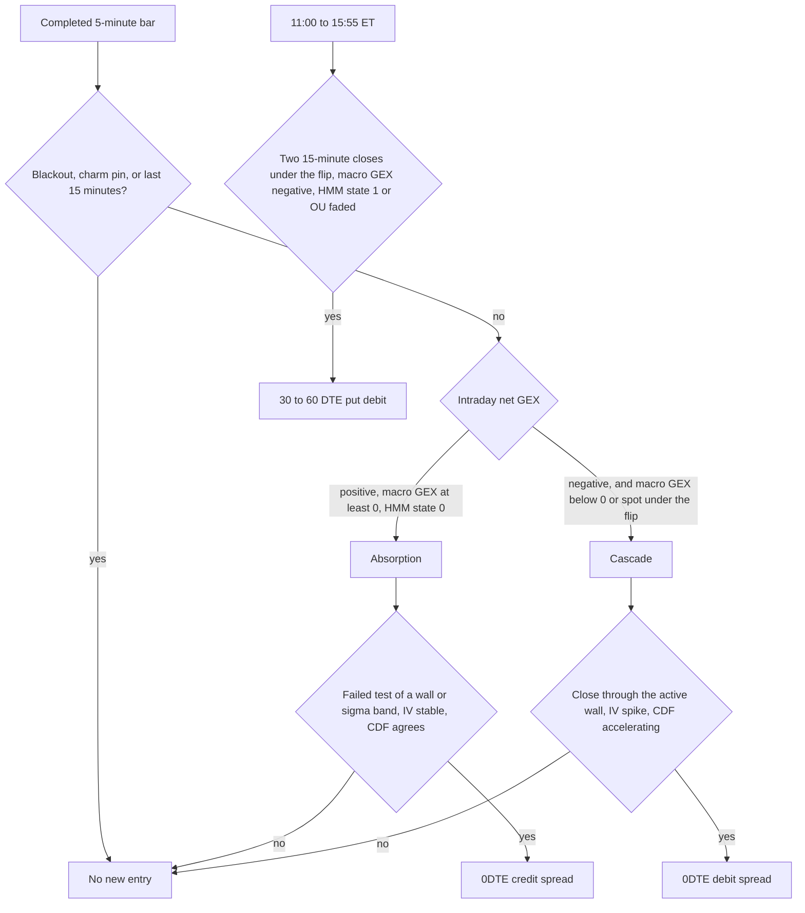
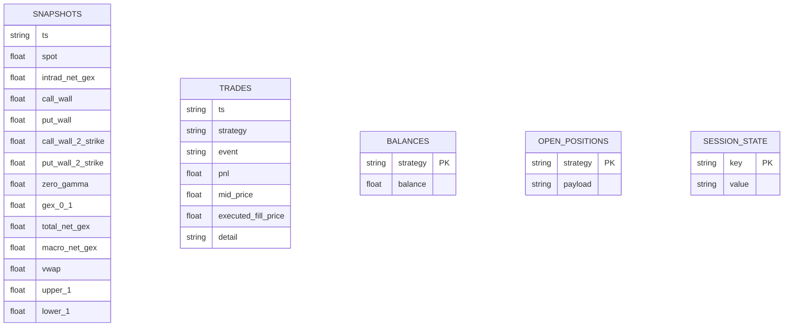

# GEXFlowTrader

Paper forward test of three SPY options strategies, with a read-only session chart. The tester polls Schwab, writes a DuckDB journal, and publishes a JSON snapshot. A second process draws that snapshot. No broker orders are sent.

The live chart is [http://129.146.241.140:8080/](http://129.146.241.140:8080/).

## System

Two containers share one data volume. The tester is the only process that talks to Schwab and the only process that opens the database. The dashboard opens the JSON file the tester rewrites after each commit.



The fast poll is the 0DTE chain. That one response carries the underlying price, so spot is not a second request. SPY minute bars refresh once a minute, /ES bars every 15 seconds, the 0–1 DTE book once a minute, and the 30–90 DTE book every 15 minutes (once a minute while a macro position is open). A quiet cycle keeps stops and flow in memory. The journal and the chart file are written once a minute, and immediately when a paper trade happens. If the chain or the write fails, that cycle is discarded: no new snapshot row and no new paper fill. The process then waits 15 seconds and doubles the wait, up to 5 minutes when nothing is open and up to 30 seconds while a 0DTE position is open. A separate thread watches the last completed poll. If that gap reaches 90 seconds with a 0DTE position still open, the tester paper-flattens it from the last good snapshot. The same flatten runs when a failure lands inside the last 10 minutes. Auth failures also ping Discord with `@everyone`. Market-data calls are paced at 1.5 per second, with a burst of four. A normal session stays near 18 requests a minute.



When the NYSE is closed the tester sleeps until the next 09:30 ET open and logs that time. CPI, NFP, and FOMC windows suppress new entries. The calendar covers the 2026 and 2027 NYSE holidays and early closes.

## What each process owns

| Process | Reads | Writes | Never does |
| --- | --- | --- | --- |
| `live_forward.py` | Schwab, `.env`, the token file | DuckDB, `live_view.json`, Discord | Send a broker order |
| `live_dashboard.py` | `live_view.json` | The HTTP response | Open DuckDB, call Schwab, hold a token |

DuckDB allows one writer. A second connection to the live file fails, which is why the chart is a file reader.

## Market data

| Book | When | Requests | What it feeds |
| --- | --- | --- | --- |
| 0DTE chain, 30 strikes, with spot | Every 5 seconds | 12/min | Walls, zero gamma, CDF, ATM IV, intraday structures, the live spot |
| SPY 1-minute bars | Every 60 seconds | 1/min | VWAP, 5-minute and 15-minute bars, HMM, OU, the price chart |
| /ES 1-minute bars | Every 15 seconds | 4/min | Momentum price, session VWAP, and 15-minute slope. SPY closes stand in when /ES is empty |
| 0DTE and 1DTE chain | Every 60 seconds | 1/min | `gex_0_1` magnitude |
| 30–90 DTE chain, 50 strikes | Every 15 minutes, or every minute while a macro position is open | under 1/min | Macro GEX, gamma flip, the macro put spread |

Schwab implied vol arrives as a percent and is stored as a decimal. Volume on the chain is already the session total, so CDF is not a cumulative sum of snapshots.

The access token is minted again when it is older than 28 minutes, and only while the tester is polling. Schwab’s refresh token lasts 7 days from the browser login that created it. Saving the rotated string in `SCHWAB_REFRESH_TOKEN_PATH` (`/data/schwab_refresh_token`, mode `600`) keeps the current string, and it does not start a new 7-day window. On expiry Schwab rejects the token request. The tester posts `@everyone` to Discord, backs off, and leaves the chart on the last good session. `get_refresh_token.py` is the browser login that mints the next refresh token. One app key has one live refresh token. A second client that refreshes the same token invalidates the server.

## Measures

Two gamma books are kept on purpose. The regime sign uses the intraday dollar-gamma book. Wall strikes and the GEX magnitudes use open interest.

**Intraday dollar gamma** (regime, zero gamma) blends open interest and session volume continuously. At 09:30 the weight is open interest. The volume share is `0.8 × (1 − e^(−0.0075 × minutes since the open))`, and the open-interest share is the rest. There is no step at 10:30.

```text
Dollar Gamma = Gamma × weight × 100 × Spot² × 0.01
```

Put dollar gamma is signed negative. Net intraday GEX is the sum. Zero gamma is the interpolated cumulative-zero closest to spot. The gamma in that zero-gamma book is Black-Scholes, marked at the live spot and each strike's own implied vol (`r = 0.04`, `q = 0.012`), with the same weights as the regime book. The regime sign still uses Schwab's quoted gamma. Cascade reads this zero-gamma strike, so an IV change moves the breakout level.

**Wall rank and GEX magnitude:**

```text
Dollar Gamma = Gamma × Open Interest × 100 × Spot
```

| Series | Definition |
| --- | --- |
| Call wall 1 / put wall 1 | Strike with the largest dollar gamma on that side |
| Call wall 2 / put wall 2 | Next strike, kept only when its dollar gamma is at least 80% of the primary. Otherwise null |
| 0–1 DTE GEX | Signed sum of that formula over expirations with 0 or 1 day to expiry |
| 30–90 DTE GEX | `(call OI × call gamma − put OI × put gamma) × 100 × spot`, summed |
| Total net GEX | 0–1 DTE GEX + 30–90 DTE GEX |

A wall or zero-gamma print that jumps more than one SPY strike ($1.01) is held until the new level repeats on the next poll. A one-strike step is accepted immediately. A secondary wall has to repeat once before it appears, and it clears only after it has been absent for two polls.

**Expected move** still left in the session, centered on VWAP. A full 390-minute day matches `spot × ATM IV × sqrt(1/252)`. The upper width uses ATM call IV and the lower width uses ATM put IV. A missing side falls back to the combined ATM average.

```text
width = Spot × side IV × sqrt(minutes left / (390 × 252))
upper 1σ = VWAP + call width
lower 1σ = VWAP − put width
2σ       = twice that width on the same side
```

Absorption and cascade use these bands, so a 1σ test and a 2σ target tighten as the close approaches.

**Volume GEX** is the same strike sum as the wall formula with session volume in place of open interest, on the 0DTE book only. It is drawn on the GEX chart. The regime sign stays on the dollar-gamma book.

**1% hedge** is `total net GEX × 0.01 × spot`: the dollars of underlying that hedge a 1% move.

**Charm to close** is the dollars of underlying the same signed book must trade by the cash close as delta decays. Charm is Black-Scholes `dDelta` per year of time passing, times the minutes still left, times 100, times spot. Calls minus puts. A positive figure means delta rises into the close, so the hedge sells shares. It is a published stat. The last-hour entry block is still the max-open-interest pin, not this greek.

ATM IV is the average of the call and put implied vol at the strike nearest spot. `atm_call_iv` and `atm_put_iv` are stored separately and drive the upper and lower bands.

**Overnight PML** is the 0DTE strike where long-option dealer liability is largest: call open interest × call gamma, plus put open interest × put gamma. At the 09:30 ET poll the tester freezes that strike with the primary call wall and primary put wall. The three values live in `SESSION_STATE` (`static_open_call_wall_1`, `static_open_put_wall_1`, `static_open_pml`, plus `static_open_day`) and stay fixed for the session. A restart reloads them. A poll after 09:30 does not invent them from a later chain.

**IV peak center** is the geometric center of the contiguous 0DTE strikes whose average call/put IV is at least 98% of the highest strike IV.

**IV max fear** is the first strike beyond the outer call wall, and beyond the outer put wall, where that side's dollar gamma is under 20% of the primary wall. The outer wall is the farther of the primary and the 80% secondary.

**ES momentum** is the last /ES price, /ES session VWAP, and the regression slope of the last 15 one-minute closes, in percent of the last price. When /ES bars are missing, the same three numbers are computed on SPY.

**CDF** is classified share-delta on the 0DTE book. The first chain of the session sets a volume baseline. After that, only the volume increase is counted. The aggressor fraction is the change in the last sale divided by half the bid-ask spread, clipped to −1…1 (bulk volume classification). A locked quote uses the sign of the spot change instead. A buyer of calls and a seller of puts add positive flow. A print that does not move adds nothing.

**HMM** is a two-state Gaussian model on 1-minute returns, refit at most every 5 minutes, and immediately after a one-minute move of 0.3% or more. State 0 is the lower-variance state.

**OU theta** is the AR(1) mean-reversion speed on those closes. Theta at or below `0.005` counts as faded mean reversion for the macro swing.

## Strategies

Each strategy has its own cash account, one open position, and a 5-minute cooldown after a stop. Intraday entries fire on a completed 5-minute bar. New 0DTE entries stop 15 minutes before the close. Open 0DTE positions flatten in the last 5 minutes.



| | Absorption | Cascade | Macro swing |
| --- | --- | --- | --- |
| Regime | Intraday GEX > 0, macro GEX ≥ 0, HMM state 0 | Intraday GEX < 0, and macro GEX < 0 or spot below the flip | Macro GEX < 0, from 11:00 through 15:55 ET |
| Extra | ATM IV within 0.002 of the 15-minute reading. CDF moves with the fade, or is flat. A bullish fade is blocked when the 15-minute slope is below −0.05%. A bearish fade is blocked when it is above +0.05% | IV up 0.005 or 3% versus 15 minutes ago. 15-minute CDF change larger than the prior 15 minutes, and in the trade direction. /ES last price must be on the breakout side of /ES VWAP, and the slope must share that sign | Two completed 15-minute SPY closes below the macro flip. HMM state 1, or OU theta ≤ 0.005 |
| Trigger | 5-minute test of the put wall, call wall, 1σ, or 2σ that fails to close through. A wall wins when both a wall and a band qualify | 5-minute close through `call_wall_2` on the upside, or `put_wall_2` on the downside, when that secondary wall exists. Otherwise the primary wall or zero gamma. Price must be on the correct side of SPY VWAP | The window, the two closes, and the regime above. A same-day exit does not re-enter |
| Structure | 0DTE credit, short strike at the tested level, long strike one strike further out | 0DTE debit, about $2 wide, long strike nearest spot | 30–60 DTE put debit, about $5 wide, expiration nearest 45 DTE. Reason starts with `ENTER_MACRO_PUT_DEBIT` |
| Stop | Live spot through the structural stop, or a loss of half the defined risk, checked on each chain poll. An upper fade stops above `iv_max_fear_upper`. A lower fade stops below `iv_max_fear_lower`. When that fear strike is missing, a 1σ fade still uses the secondary wall | Live spot back through zero gamma, or a loss of half the defined risk | Next session: HMM back in state 0. Or, in the closing 5 minutes, spot back above the flip or macro GEX ≥ 0 |
| Take profit | Half the credit, spot back to VWAP or zero gamma, or spot touching the IV peak center. Taken only when the close is green after fees | Spot reaches the 2σ band in the trade direction, or CDF stays flat for three minute-samples. Taken only when the close is green after fees | The exit rules above |
| Flatten | Last 5 minutes | Last 5 minutes | Held overnight |

A quote is skipped when the combined bid-ask width is more than `SPREAD_BA_MAX_RATIO` (default 5%) of the structure's mid value, when the premium is under $0.05, or when the credit or debit is wider than the strikes. The charm guard blocks new entries in the last hour when spot is within 0.15% of the 0DTE strike with the most open interest.

A take-profit event is written only when the marked close is positive after fees. A red absorption fade, a red 2σ touch, or a red CDF reading stays open for the stop or the session flatten. Cascade's CDF exit also waits until the 15-minute change has been inside 5% of the cumulative CDF for three minute-samples in a row. One quiet minute does not close it.

## Paper account

| Rule | Value |
| --- | --- |
| Starting balance | `INITIAL_BALANCE` per strategy, default $100,000. Cumulative is the sum |
| Risk | 2% of that strategy's balance |
| Size | Whole contracts, max loss inside the risk budget, cap 25 |
| Fees | $0.65 × contracts × legs × 2 |
| Mark | Signed mid minus a spread factor × the summed bid-ask width on the way in, and plus that amount on the way out. Absorption and macro start at `SLIPPAGE_SPREAD_FACTOR` (default 0.35) and rise toward 0.50 when the live width exceeds the narrowest width seen, or the width stored at entry. Cascade entries, stops, and flattens cross the spread (factor 1). A stop or flatten may fall back to intrinsic when quotes are missing |
| Reject | A debit whose fill is at least as wide as the strikes, or a credit fill of $0.05 or less, is not opened |
| PnL | `(entry fill − closing fill) × 100 × contracts − fees`. The signed mid is short mid minus long mid, so a credit is positive. `TRADES` stores `mid_price` and `executed_fill_price` |

## Storage

`DUCKDB_PATH` defaults to `forward_test.db`. Compose mounts `./data` at `/data`.



`SESSION_STATE` also holds `static_open_day`, `static_open_call_wall_1`, `static_open_put_wall_1`, and `static_open_pml` for the session that locked them.

`live_view.json` is replaced atomically beside the database. It holds the latest session only: price levels, the three static opening levels, CDF, ATM IV, the GEX series, balances, open positions, and trades. A gap longer than three minutes is a break in the line. The publisher recomputes the expected-move bands from stored spot, VWAP, ATM IV, and the call and put IVs when those columns exist, and it replays the wall filter, so a chart rebuilt from an older file still uses the current level rules. The static lines are published only when `static_open_day` matches the session.

## Chart

[http://129.146.241.140:8080/](http://129.146.241.140:8080/) polls `/api/session` once a minute. A failed read keeps the last chart and retries once. `/health` returns `ok`.

| Series | Drawing |
| --- | --- |
| Price | Session one-minute history, replaced each poll, with the latest spot in the current bar |
| VWAP | Solid gray |
| 1σ | Dotted purple, remaining-session expected move around VWAP |
| Call wall 1 | Solid red |
| Call wall 2 | Dashed red, omitted when null |
| Put wall 1 | Solid green |
| Put wall 2 | Dashed green, omitted when null |
| Zero gamma | Solid gold |
| Open call wall | Dotted red, the 09:30 primary call wall |
| Open put wall | Dotted green, the 09:30 primary put wall |
| Open PML | Dotted gray, the 09:30 peak-liability strike |
| Net GEX | Total, 0–1 DTE, 0DTE volume, and 30–90 DTE |
| Price | One-minute candles, VWAP, remaining-session 1σ, walls |
| PnL | Change from each balance at the session open |

Clock labels are America/New_York. The price scale follows spot, the 1σ bands, and the opening reference lines. The 2σ levels stay in the signal logic: absorption can still fade a failed 2σ test, and cascade still takes profit when spot reaches 2σ. They are not drawn.

## Layout

| Module | Responsibility |
| --- | --- |
| `live_forward.py` | Session loop, persistence, Discord, paper positions |
| `live_market.py` | Schwab session, chains, bars, token rotation |
| `live_signals.py` | Entry rules, structures, HMM, OU, slippage, fees |
| `live_view.py` | JSON publisher |
| `live_dashboard.py` | Read-only chart server |
| `gex_engine.py` | Strike GEX, dollar gamma, walls, PML, IV peak, max fear, CDF, ATM IV, level filter |
| `ta_engine.py` | VWAP and expected-move bands |
| `signal_engine.py` | Macro gamma flip |
| `event_calendar.py` | NYSE hours, holidays, CPI / NFP / FOMC blackouts |
| `test_forward_logic.py` | Logic checks, no network |
| `docker-compose.yml` | Tester and dashboard |
| `Dockerfile` | `python:3.11-slim` image used by both services |

## Run

```bash
python3 -m venv .venv
source .venv/bin/activate
pip install -r requirements.txt
python3 test_forward_logic.py
```

Copy `.env.example` to `.env` on the host that will poll Schwab. Do not commit `.env`, the database, or the token file.

```text
SCHWAB_APP_KEY
SCHWAB_APP_SECRET
SCHWAB_REFRESH_TOKEN
SCHWAB_REFRESH_TOKEN_PATH=/data/schwab_refresh_token
DISCORD_WEBHOOK_URL
DUCKDB_PATH=/data/forward_test.db
SPREAD_BA_MAX_RATIO=0.05
SLIPPAGE_SPREAD_FACTOR=0.35
INITIAL_BALANCE=100000
```

The current deployment is `/home/ubuntu/spy-forward` on the Oracle VM. Compose builds one image and starts both processes. The dashboard publishes port 8080. The tester has no published ports.

```bash
docker compose up -d --build
```

A restart sends a Discord message that the forward test started. While the market is closed the process waits for the next open.

## Operate

- Watch the session at [http://129.146.241.140:8080/](http://129.146.241.140:8080/). The page is enough. There is no local chart process.
- Keep a single Schwab session. Refreshing the same app key anywhere else rotates the token out from under the tester.
- About 7 days after the last browser login, run `python3 get_refresh_token.py` on your machine (it listens on `https://127.0.0.1:8080`, which is not the server chart). Stop `spy-forward`, write the new `SCHWAB_REFRESH_TOKEN` into `.env` and into `/data/schwab_refresh_token`, then start it again. The file wins over `.env`. Leaving the tester running during that swap can overwrite the new token with a refresh of the old one.
- The dashboard container mounts `./data` read-only and has no `.env`.
- Logs: `docker logs spy-forward` and `docker logs spy-dashboard`.
- A failed poll is visible in Discord and in the tester log. The chart simply shows a gap.
